<p align="center">
  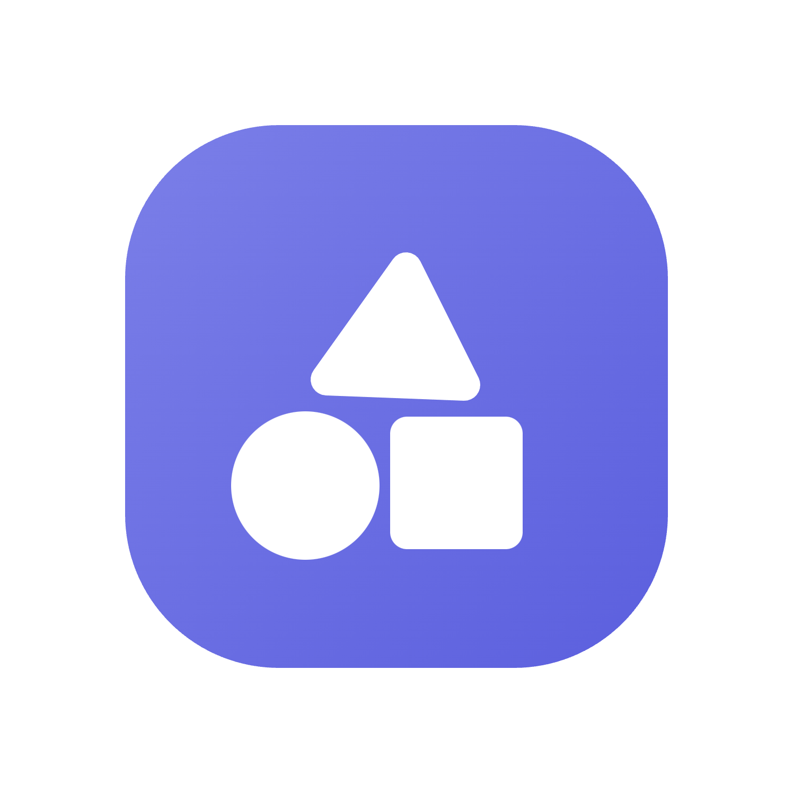
</p>


<h1 align="center">Orion Store</h1>

<p align="center">
  <a href="https://github.com/RookieEnough/Orion-Store/stargazers"></a>
  <a href="https://github.com/RookieEnough/Orion-Store/network/members"></a>
</p>

<p align="center">
  A transparent app store built around public releases, inspectable metadata, and automation you can actually follow.<br>
  <strong>Now fully native.</strong>
</p>

<p align="center">
  
  
  
  
</p>

<p align="center">
  <a href="https://ko-fi.com/rookie_z" target="_blank"></a>
  &nbsp;&nbsp;
  <a href="https://buymeachai.ezee.li/RookieZ" target="_blank"></a>
  <br />
  <a href="https://paypal.me/RookieEnough" target="_blank"></a>
</p>

<br>

<p align="center">
  <a href="https://github.com/RookieEnough/Orion-Store/releases">
    
  </a>
  <a href="https://github.com/RookieEnough/Orion-Store/releases">
    
  </a>
  <a href="https://orionstore.pages.dev">
    
  </a>
</p>

<p align="center">
  <strong>Sources Supported</strong><br>
  <a href="https://github.com"></a>
  <a href="https://gitlab.com"></a>
  <a href="https://codeberg.org"></a>
</p>

<br>
<p align="center">
<a href="https://trendshift.io/repositories/15654?utm_source=trendshift-badge&amp;utm_medium=badge&amp;utm_campaign=badge-trendshift-15654" target="_blank" rel="noopener noreferrer"></a>
</p>

## Orion Store 2.0 · Native at last :rocket:

Orion Store has been **rebuilt from the ground up as a native Android app**. The web app has been rewritten in Kotlin and Jetpack Compose on **Material 3 Expressive**, with spring motion, shape morphing, a new storefront and features that were never possible before. Updating from 1.x is a normal install over the old app, and your profile, XP, badges, favorites and settings come along.

Read the full [2.0.0 release notes](RELEASE_NOTES_2.0.0.md).

## Overview :milky_way:

Orion Store is an Android-first store client that leans on public sources instead of hiding everything behind a private service layer. The app pulls catalog data from public JSON, resolves releases from GitHub, GitLab, and Codeberg, and keeps the delivery path understandable enough that users can see where things come from and how updates are discovered.

This repository is the client application itself. The live catalog, configuration, notices, and release metadata used by the app are maintained separately in [RookieEnough/Orion-Data](https://github.com/RookieEnough/Orion-Data), which keeps the UI and the store data cleanly separated.

> Orion is built for people who care where software comes from, not just how quickly it downloads.

At a glance:

- Public JSON catalog with inspectable configuration
- Multi-source releases (GitHub, GitLab, Codeberg)
- Native install, update, and security tooling
- Skip Android's 24-hour unverified-app wait with built-in wireless install

## What makes Orion different :sparkles:

The point of Orion is not to pretend infrastructure does not exist. It is to reduce hidden infrastructure and move as much of the important behavior as possible into public, inspectable layers. Catalog entries are plain data. Release sources stay visible. Automation is handled through workflows and workers that can be reviewed, rather than through a black-box backend that users have to trust on faith.

That design carries through the app. Orion tracks installed packages, surfaces updates, manages download state, installs natively, and exposes developer-facing diagnostics for people who want to see what the store is actually doing under the hood.

## Feature atlas :compass:

<p align="center">
  
</p>

<table>
  <tr>
    <td width="50%" valign="top">
      <br>
      <strong>Release intelligence</strong><br>
      Orion reads public metadata, resolves upstream releases, and keeps source provenance visible instead of burying it behind a store-owned backend. It reads your device architecture and recommends the right APK.<br><br>
      <code>Public JSON</code> <code>Mirrors</code> <code>Multi-source parsing</code> <code>ABI detection</code>
    </td>
    <td width="50%" valign="top">
      <br>
      <strong>Update center</strong><br>
      A native download engine with live notifications, a persistent queue, batch updates, and per-app ignore rules you can undo from My Apps.<br><br>
      <code>Foreground downloads</code> <code>Queue</code> <code>Ignored updates</code>
    </td>
  </tr>
  <tr>
    <td width="50%" valign="top">
      <br>
      <strong>Native install flow</strong><br>
      System installer, a specific installer, Shizuku silent installs, or the built-in <strong>wireless ADB</strong> installer that skips Android's 24-hour wait for unverified apps. Set it up once through a guided notification.<br><br>
      <code>Wireless ADB</code> <code>Shizuku</code> <code>Installer choice</code>
    </td>
    <td width="50%" valign="top">
      <br>
      <strong>Sentinel security</strong><br>
      Security tooling is built into the product: malware scans for installed apps and VirusTotal checks for any APK before it is installed.<br><br>
      <code>Sentinel</code> <code>VirusTotal</code> <code>Threat database</code>
    </td>
  </tr>
  <tr>
    <td width="50%" valign="top">
      <br>
      <strong>Guardian power tools</strong><br>
      Revoke risky permissions, pull the APK out of any app, and remove or restore system apps without root, rated by the Universal Android Debloater database.<br><br>
      <code>Permissions</code> <code>APK extraction</code> <code>Debloater</code>
    </td>
    <td width="50%" valign="top">
      <br>
      <strong>Developer visibility</strong><br>
      Mirror source, cache state, GitHub API quota, package detective, raw metadata explorer and source switching, all in Settings › Developer.<br><br>
      <code>Developer mode</code> <code>Diagnostics</code> <code>Metadata inspection</code>
    </td>
  </tr>
</table>

### And a lot more

- **Material 3 Expressive design:** expressive springs, shape morphs, wavy progress, icon hand-off animations, and Material You colors.
- **A real level system:** every ad, download, submission and Dino Run earns XP. Pilot cards turn Bronze, Silver and Gold, and you can flip yours to sign it.
- **Fuel the Code:** a story-driven support quest, now in Chapter 2 · The Forkening, with bosses and badges to earn.
- **Community:** submit apps straight from a GitHub, GitLab or Codeberg repo, build custom bundles, and climb the leaderboard.
- **Personalization:** light, dark, dusk and OLED themes, custom fonts, pixel pull-to-refresh characters, layouts and visible tabs.

## Screenshots :framed_picture:

<table>
  <tr>
    <td width="25%" align="center">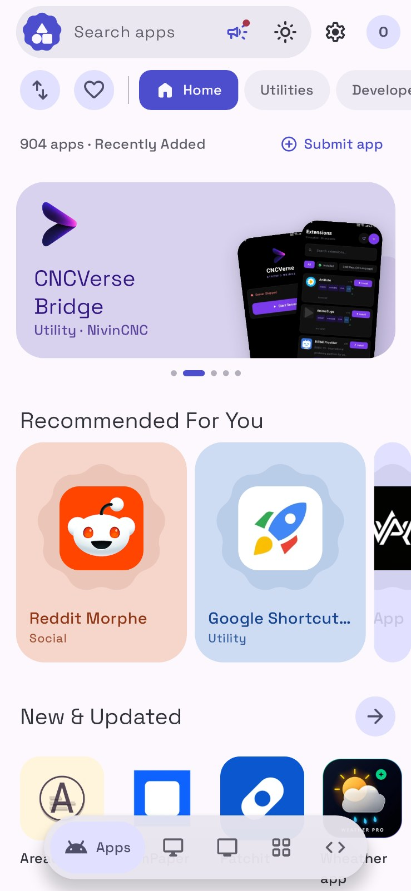<br><sub>Storefront</sub></td>
    <td width="25%" align="center"><br><sub>App details</sub></td>
    <td width="25%" align="center">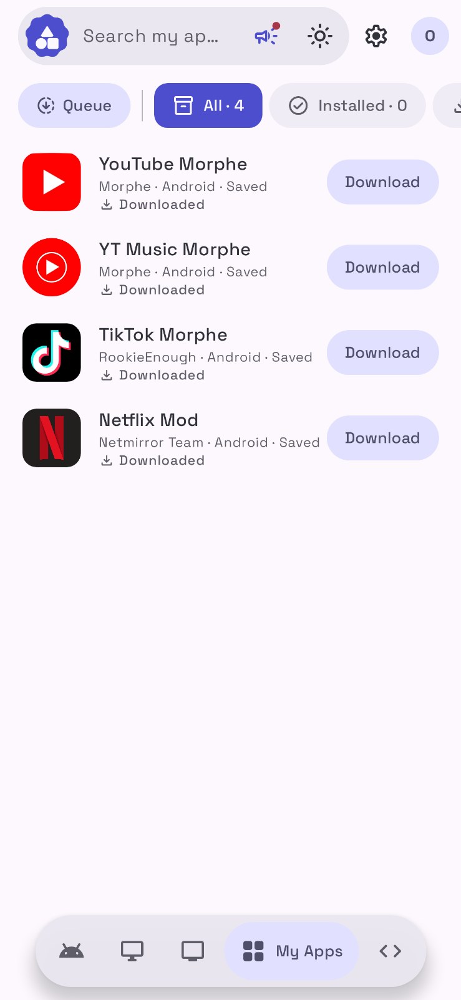<br><sub>My Apps</sub></td>
    <td width="25%" align="center">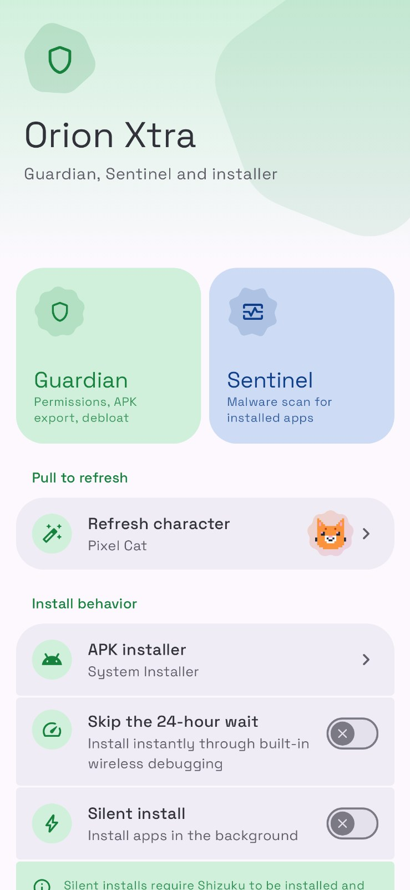<br><sub>Orion Xtra</sub></td>
  </tr>
  <tr>
    <td width="25%" align="center">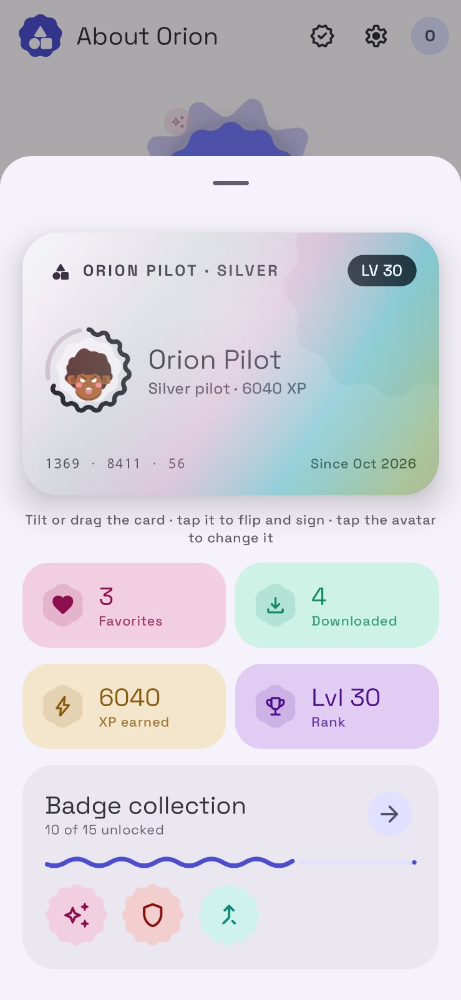<br><sub>Pilot profile</sub></td>
    <td width="25%" align="center">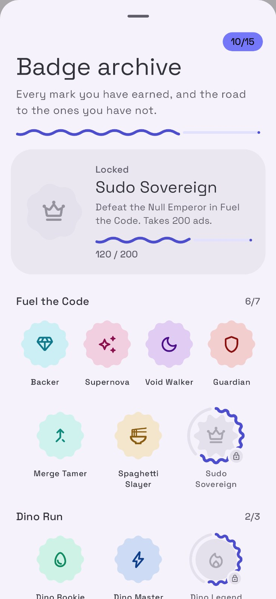<br><sub>Badge archive</sub></td>
    <td width="25%" align="center">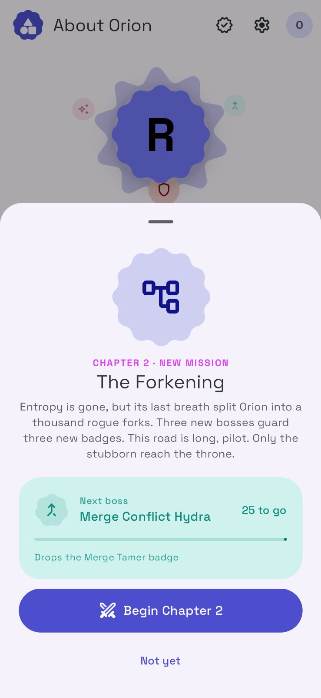<br><sub>Fuel the Code</sub></td>
    <td width="25%" align="center">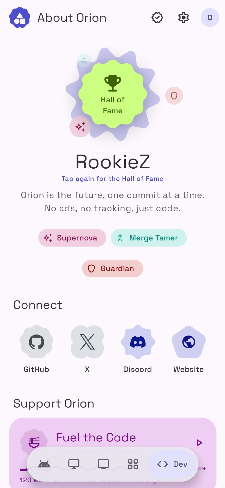<br><sub>About</sub></td>
  </tr>
  <tr>
    <td width="25%" align="center">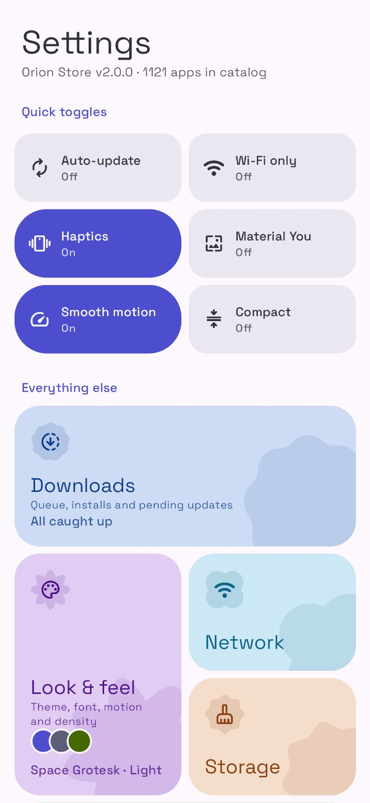<br><sub>Settings</sub></td>
    <td width="25%" align="center">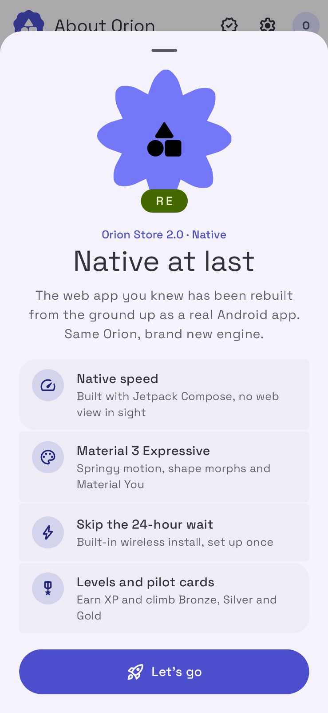<br><sub>Welcome to 2.0</sub></td>
    <td width="25%" align="center">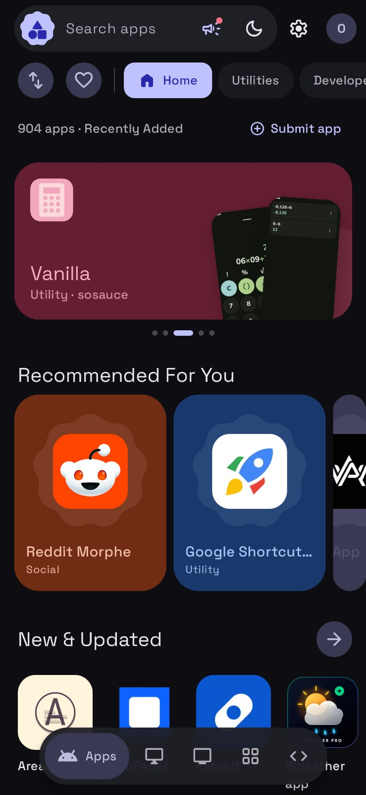<br><sub>Dark theme</sub></td>
    <td width="25%" align="center">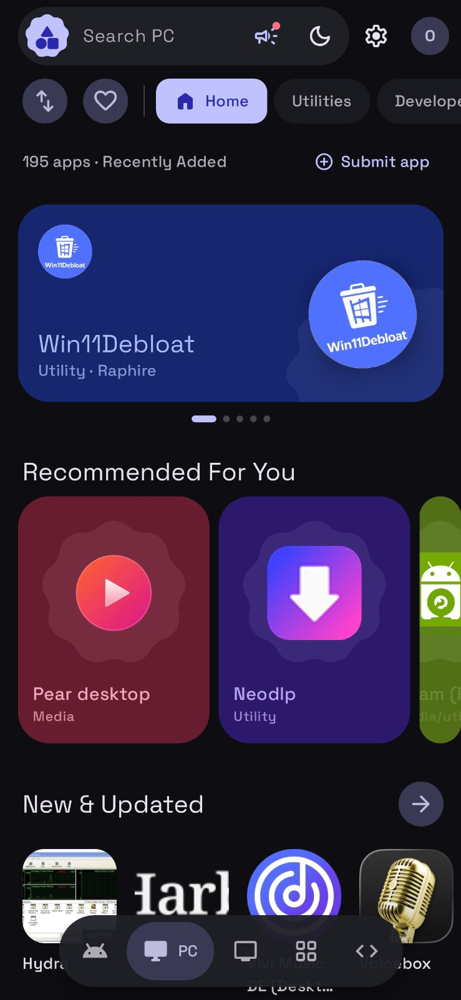<br><sub>PC catalog</sub></td>
  </tr>
</table>

<p align="center">
  <a href="https://www.youtube.com/watch?v=dIzAipwgj6A">
    
  </a>
</p>

## Official Developer Badges :trophy:

If you are a developer, you can promote that your application is hosted on Orion Store by adding our official badge to your repository's readme or your product website.

<p align="center">
  
</p>

### How to Get Your Badge Integration Link:
1. **Submit Your App**: Submit your application to the Orion Store via this client or our repository submission form.
2. **Enable Developer Mode**: Once approved and live in the store, open Orion Store and tap the **Orion Store** title in the header 7 times to unlock Developer Mode.
3. **Copy Integration Code**: Open your app's detail page, expand **Developer Deep Links**, and copy the **Markdown Badge** for your repository's README or the **HTML Badge** for your website.

## How the project is structured :card_file_box:

Orion Store 2.0 is a single-activity Jetpack Compose app in MVVM style. A tour of the code lives in [ARCHITECTURE.md](ARCHITECTURE.md).

<table>
  <tr>
    <td><strong>Area</strong></td>
    <td><strong>Responsibility</strong></td>
  </tr>
  <tr>
    <td><code>app/src/main/java/com/orion/store/ui/</code></td>
    <td>Compose screens, the theme and motion system, and <code>MainViewModel</code>, which orchestrates loading, downloads, installs and overlays</td>
  </tr>
  <tr>
    <td><code>app/src/main/java/com/orion/store/data/</code></td>
    <td>Catalog processing, persisted settings and data stores, version logic, XP and levels</td>
  </tr>
  <tr>
    <td><code>app/src/main/java/com/orion/store/platform/</code></td>
    <td>Package tracking, the download service, Shizuku and wireless ADB installs, VirusTotal, and the 1.x data carry-over</td>
  </tr>
  <tr>
    <td><code>tools/</code></td>
    <td>Generators for the Material Symbols icon set and the color schemes</td>
  </tr>
  <tr>
    <td><code>Orion Legacy/</code></td>
    <td>The original React + Capacitor web app (1.x), kept for reference and for the web build</td>
  </tr>
</table>

## Building :hammer_and_wrench:

You need **JDK 21** (the JetBrains Runtime bundled with Android Studio works) and the Android SDK.

```bash
./gradlew :app:assembleDebug          # debug APK
./gradlew :app:testDebugUnitTest      # logic tests
```

Release builds read the signing key from a local `keystore.properties` (never committed):

```properties
storeFile=/path/to/your.keystore
keyAlias=your-alias
storePassword=...
keyPassword=...
```

```bash
./gradlew :app:assembleRelease
```

Or open the project folder in Android Studio and run the `app` configuration on a device.

### Legacy web app

The 1.x web app lives in [`Orion Legacy/`](Orion%20Legacy) and still builds as before:

```bash
cd "Orion Legacy"
npm install
npm run dev
```

## Data, workers, and automation :robot:

Orion is best understood as backend-light rather than backend-free. The catalog and remote configuration are public, but the project still uses a few narrow pieces of infrastructure where they make sense: Cloudflare worker code for leaderboard relay, image proxying, delta aggregation, submission handling and Sentinel support lives in `Orion Legacy/workers/`, and automation runs through GitHub Actions here and in Orion-Data.

That split is intentional. The app stays focused on the client, while the data and automation layers remain separately inspectable.

## Contributing :handshake:

Contributions are welcome, especially in the areas that matter most to a store client: installer reliability, release resolution, UI polish, Android behavior, security tooling, and documentation. If you are changing catalog entries or store metadata, that work usually belongs in the data repository or the submission flow rather than in this client codebase.

Start with [ARCHITECTURE.md](ARCHITECTURE.md), then `ui/MainViewModel.kt`, `data/CatalogProcessor.kt` and `platform/AppTracker.kt` for how the store loads data, resolves releases and installs apps.

## Community :speech_balloon:

The project lives across a few public surfaces:

- `Website`: [orionstore.pages.dev](https://orionstore.pages.dev)
- `Orion-Data`: [github.com/RookieEnough/Orion-Data](https://github.com/RookieEnough/Orion-Data)
- `Discord`: [discord.com/invite/CrM6y4ujnq](https://discord.com/invite/CrM6y4ujnq)
- `Ko-fi`: [ko-fi.com/rookie_z](https://ko-fi.com/rookie_z)
- `PayPal`: [paypal.me/RookieEnough](https://paypal.me/RookieEnough)
- `UPI ID`: `rookiez@ptyes`

---

<p align="center">
  Made with 💜 by <strong>RookieZ</strong>
</p>
